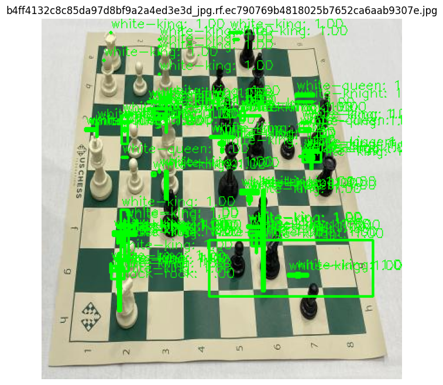

# Chess Piece Detection — YOLOv3 from Scratch

[](https://www.python.org/)
[](https://www.tensorflow.org/)
[](https://keras.io/)
[](https://opencv.org/)
[](LICENSE)
[](https://public.roboflow.com/object-detection/chess-full)

Chess piece detection on board photos. **YOLOv3 is implemented from scratch** (Darknet-53 + three YOLO heads), without pretrained weights and without ready-made Ultralytics / darknet implementations. 12 classes: white and black king, queen, bishop, knight, rook, pawn.

---

## 📸 Example Result



*Result after 10 epochs with MSE loss on 606 images. The model finds pieces but produces many false and overlapping boxes — see the detailed analysis in [Why the Output Is a Mess](#why-the-output-is-a-mess).*

---

## 🎯 About the Project

An educational project: it demonstrates that the author understands **the internals of YOLOv3** — from Darknet-53 residual blocks to decoding the outputs of three heads and NMS.

| Implemented manually | Where in code |
|---|---|
| Darknet-53 (53 conv layers, residual blocks) | `Darknet53()`, `ResUnit()`, `ResN()`, `DBL()` |
| Three YOLO heads: 13×13, 26×26, 52×52 | `YoloHead()`, `YoloHeadOutput()` |
| Decoding outputs into boxes (no exp) | `yolo_boxes_direct()` |
| Loss function (MSE — see below) | `YoloLossSimple()` |
| Data generator with IoU-based anchor assignment | `transform_targets_safe()`, `generator_safe()` |
| Protection against degenerate annotations | `parse_annotation_safe()` |
| NMS + box rescaling to original image size | `detect_image()` |

---

## 📦 Dataset

Same class set and folder structure as the public Roboflow dataset:

🔗 **<https://public.roboflow.com/object-detection/chess-full>**

- **Train:** 606 images
- **Valid:** 58 images
- **Test:** 29 images
- **12 classes:** `white-king`, `white-queen`, `white-bishop`, `white-knight`, `white-rook`, `white-pawn`, `black-king`, `black-queen`, `black-bishop`, `black-knight`, `black-rook`, `black-pawn`

Annotations use the standard YOLO `.txt` format:

```
<class_id> <x_center> <y_center> <width> <height>   # all values normalized to [0, 1]
```

### Structure After Extraction

```
chess_yolo/
├── train/images/   train/labels/
├── valid/images/   valid/labels/
└── test/images/    test/labels/
```

> ⚠️ The original dataset contains degenerate boxes (`bh = 0.0`) and coordinates outside `[0, 1]`. All of them are dropped/clipped in `parse_annotation_safe()`.

---

## 🚀 Installation and Run

### 1. Clone

```bash
git clone https://github.com/<username>/chess-piece-yolov3.git
cd chess-piece-yolov3
```

### 2. Virtual Environment

**Windows (PowerShell):**

```powershell
python -m venv .venv
.\.venv\Scripts\Activate.ps1
```

**Linux / macOS:**

```bash
python -m venv .venv
source .venv/bin/activate
```

### 3. Dependencies

```bash
pip install -r requirements.txt
```

Contents of `requirements.txt`:

```
tensorflow>=2.16,<2.20
tf-keras
opencv-python
matplotlib
numpy
pillow
```

> For GPU: `pip install "tensorflow[and-cuda]"` instead of `tensorflow`.

### 4. Dataset

Put `chess_yolo.zip` into the project root **or** unpack `chess_yolo/` manually:

```
chess-piece-yolov3/
├── yolov3_chess.py
├── requirements.txt
├── chess_yolo.zip                ← put it here
└── models/                       ← created automatically
```

The script locates the folder containing `train/images` via recursive glob — regardless of whether the zip is flat or two-level.

### 5. Run

```bash
python yolov3_chess.py
```

Stage flags are at the top of the file:

```python
CLEAN_DATA   = True   # sanitize train/labels (backup is made once)
DO_TRAIN     = True   # training
DO_INFERENCE = True   # inference on test/ or train/ images
```

### 6. Google Colab

If you train in Colab, the dataset can be downloaded automatically:

```python
URL = 'https://storage.yandexcloud.net/academy.ai/CV/chess_yolo.zip'
```

A ready notebook is available in `notebooks/colab_yolov3_chess.ipynb`.

---

## ⚙️ Default Hyperparameters

| Parameter | Value | Note |
|---|---|---|
| `INPUT_SIZE` | `416` | YOLOv3 default |
| `BATCH_SIZE` | `4` | Too small for BatchNorm — see below |
| `EPOCHS` | `10` | Demo run |
| `LR` | `1e-4` | Adam, `clipnorm=1.0` |
| `ANCHORS` | 9 standard YOLOv3 | Not recomputed for the chess dataset |
| `ANCHOR_MASKS` | `[[6,7,8],[3,4,5],[0,1,2]]` | Large → small grids |

---

## 📊 Results Analysis

### What We Got After 10 Epochs

| Epoch | `loss` (total) | `val_loss` |
|---|---|---|
| 1 | 18 617 | 11 595 |
| 2 | 18 118 | 11 599 |
| 3 (step 75) | ~18 100 | — |
| 3 (end) | 18 617 | 11 595 |

**The loss plateaued after the first epoch.** Between epochs 1 and 2 the change was −2.7%, and `val_loss` did not move at all (11 595 → 11 599). Another 90 epochs would sit at the same value — this is **a plateau, not slow training**.

### What Is Visible in `doc/1.png`

- ✅ **The model finds pieces** — boxes cluster around real pieces, not randomly across the image.
- ✅ **Rescaling is correct** — boxes align with the original image size, not the 416×416 coordinates.
- ❌ **Many overlapping boxes** — NMS cannot clean them up because `obj` is predicted as ≈1 almost everywhere.
- ❌ **Class labels are unreliable** — the model confuses similar pieces (bishop ↔ queen, knight ↔ rook).
- ❌ **False detections on empty squares** — the background is not penalized (see below).

Acceptable as a demonstration of the architecture. Not acceptable for real use.

---

## 🔍 Why the Output Is a Mess

The "mess" of overlapping boxes is **not caused by 10 epochs**. Even 100 epochs with this configuration would produce the same result. The reasons, ordered by priority:

### 1. 🔴 Bug in `obj_loss`: the background is not penalized

In `YoloLossSimple`:

```python
obj_mask = tf.squeeze(true_obj, -1)

xy_loss    = tf.reduce_sum(tf.square(true_xy - pred_xy),   axis=-1) * obj_mask
wh_loss    = tf.reduce_sum(tf.square(true_wh - pred_wh),   axis=-1) * obj_mask
obj_loss   = tf.squeeze(tf.square(true_obj - pred_obj), -1)      * obj_mask  # ← here
class_loss = tf.reduce_sum(tf.square(true_cls - pred_class), -1) * obj_mask
```

`obj_mask = 0` for cells **without** an object (99% of all cells). Hence:

- For a cell with a piece: `obj_loss` penalizes the model → it learns `pred_obj ≈ 1` ✅
- For an **empty** cell: `obj_loss = 0` **regardless of the prediction** → the model can output `pred_obj ≈ 1` everywhere and receive no penalty at all ❌

At inference this produces **thousands of false boxes** before NMS, and NMS with `iou_threshold=0.6` cannot filter them all out — hence the "mess".

**How to fix.** Penalize the background with a smaller weight:

```python
obj_weight = obj_mask + 0.5 * (1.0 - obj_mask)
obj_loss = tf.squeeze(tf.square(true_obj - pred_obj), -1) * obj_weight
```

Positives weight=1.0, background weight=0.5 — standard YOLO practice. Total loss will **increase** (because the background now contributes), but thousands of false boxes will disappear at inference.

### 2. 🟡 MSE is a weak signal for classification

`tf.square(true_cls - pred_class)` produces a gradient of at most 1.0. Classical BCE with logits produces much more. MSE was chosen **as a workaround** — to eliminate `nan` on an untrained network (see [Why MSE](#why-mse)) — not for quality.

**How to fix.** Return to BCE but **clip the logits**:

```python
logits = tf.clip_by_value(logits, -20.0, 20.0)
loss = tf.nn.sigmoid_cross_entropy_with_logits(labels=true, logits=logits)
```

This gives the full strength of BCE gradients while avoiding `inf` / `nan`, because `exp(±20)` still fits in float32.

### 3. 🟡 `batch=4` + BatchNorm — unstable gradients

BN on a batch of 4 images produces very noisy statistics. Hence the loss jumps between adjacent batches (10 521 → 15 814 → 19 755 within a single epoch).

**How to fix.** `BATCH_SIZE=8` or `16`. Memory allows — Darknet53 at 416×416 in float32 uses ~5 GB VRAM at batch=8, which fits in a T4 (15 GB).

### 4. 🟡 606 images for 60M parameters from scratch

YOLOv3 has 60M parameters. Standard training uses COCO (118k images, 80 classes) with a **pretrained** backbone. We have 606 images, 12 classes, **from scratch**. Even 100 epochs on such a small dataset leads to overfitting, not generalization.

**How to fix.** Load pretrained Darknet53 weights (ImageNet) and fine-tune only the heads. This yields real progress on a small dataset.

### 5. 🟢 LR = 1e-4 is too high for an untrained network

In the first epochs logits reach ±100 000 (this is the source of the original `nan` with cross-entropy). `clipnorm=1.0` helps, but the LR is still too high.

**How to fix.** `LR = 3e-5` for the first 10 epochs; `ReduceLROnPlateau` (already enabled) will then reduce it to `1.5e-5`.

### 6. 🟢 Anchors are not recomputed for the dataset

Standard COCO anchors (10×13 … 373×326) are used, but chess pieces in board photos have **different proportions** (vertically elongated, small relative to the frame).

**How to fix.** Recompute anchors via k-means over all bboxes in `train/labels`:

```bash
python scripts/kmeans_anchors.py --labels chess_yolo/train/labels --k 9
```

---

## 🛠️ Theory: Roadmap for Improvements

If you want **real detection** rather than a demo, follow this order:

### Stage 1 — Minimal Fixes (1–2 hours of coding)

- [ ] Fix `obj_loss` (item 1 above) — **mandatory**, everything else is meaningless without it
- [ ] `LR = 3e-5`, `BATCH_SIZE = 8`, `INPUT_SIZE = 320`
- [ ] Retrain from scratch, 20–30 epochs
- [ ] Expected: total loss **increases** to 25–30k (because the background now contributes), but thousands of false boxes disappear in `doc/1.png`

### Stage 2 — Proper Loss (2–3 hours)

- [ ] Replace MSE with BCE for `obj` and `cls`, using `tf.clip_by_value(logits, -20, 20)`
- [ ] Keep MSE only for `xy` (or switch to CIoU, the YOLOv4+ standard)
- [ ] Retrain, 30–50 epochs
- [ ] Expected: `val_loss` starts **monotonically decreasing** (no plateau), mAP@0.5 rises from ~0.1 to ~0.4–0.5

### Stage 3 — Pretrained Backbone (3–4 hours)

- [ ] Download Darknet53 ImageNet weights (e.g. from [YAD2K](https://github.com/allanzelener/YAD2K))
- [ ] Load into `Darknet53()` via `model.load_weights(..., by_name=True)`
- [ ] Fine-tune everything with `LR = 1e-4`, 20–30 epochs
- [ ] Expected: mAP@0.5 → 0.6–0.7, this is already real detection

### Stage 4 — If You Need a Product, Not a Learning Project

- [ ] Take **YOLOv8n** (ultralytics) with `yolov8n.pt` pretrained on COCO
- [ ] Run training:

```bash
yolo detect train data=chess.yaml model=yolov8n.pt epochs=50 imgsz=640
```

- [ ] 1 hour on a T4 → mAP@0.5 ≈ 0.85–0.95
- [ ] This YOLOv3 from scratch will **never** reach that on 606 images — and that's fine

> 💡 **Honest summary.** The project is valuable as a **learning exercise** — it demonstrates understanding of the architecture. As a **product** it loses to any pretrained pipeline. Both options are valid, but they are different tasks. Don't try to "train up to quality" this YOLOv3 — you'll spend 20 hours on CPU and get mAP ~0.2. If you need results — Stage 4.

---

## ❓ Why MSE

On the original dataset and with an untrained network, **classical cross-entropy yields `loss: nan`**. Reason: logits reach ±100 000, `exp(100 000) = inf`, `log(inf) = inf`, `inf - inf = nan`. Neither `clipnorm` nor `BatchNorm` fully prevents this in the first batches.

The workaround is **MSE**, which has neither exponentials nor logarithms:

```python
obj_loss = tf.square(true_obj - pred_obj)
```

The loss stops being `nan`. **But** MSE is a weaker gradient than BCE, so the model learns more slowly and separates close classes worse. It is a compromise for a demo, not for production.

---

## 📁 Project Structure

```
chess-piece-yolov3/
├── yolov3_chess.py              # all code: architecture, loss, generator, training, inference
├── requirements.txt
├── README.md
├── .gitignore
├── doc/
│   └── 1.png                    # example result
├── notebooks/
│   └── colab_yolov3_chess.ipynb # Google Colab version
├── models/                      # created automatically, *.keras checkpoints
└── chess_yolo.zip               # dataset (not committed, in .gitignore)
```

---

## ⚠️ Limitations

- **CPU training** — 20–40 minutes per epoch at `INPUT_SIZE=416`, `BATCH_SIZE=4`. On an i5, ten epochs take ~6 hours. For a CPU demo use `INPUT_SIZE=320`, `BATCH_SIZE=2`, `EPOCHS=3`.
- **BatchNorm at `batch=4`** — unstable gradients, loss jumps between batches.
- **MSE loss** — weak signal, slow convergence.
- **No pretrained backbone** — 60M parameters trained from scratch on 606 images is inherently insufficient.
- **Small dataset** — 606 train / 58 valid / 29 test. Not enough for high accuracy on 12 classes.

All limitations are educational and do not block the pipeline. The project runs and works as a demo.

---

## 📄 License

MIT — see the [LICENSE](LICENSE) file.
